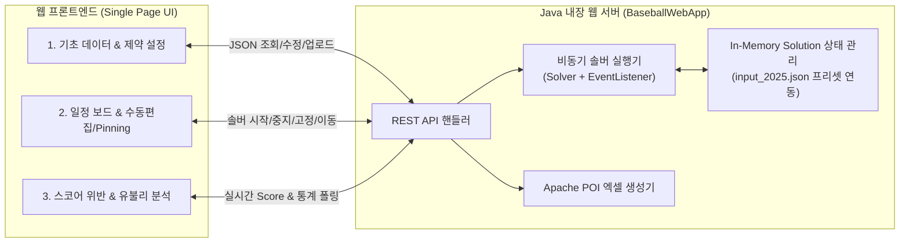

# KBO 프로야구 일정 수립 솔버 웹 서비스 설계서

본 문서는 기존에 개발된 OptaPlanner 기반 한국프로야구(KBO) 일정 최적화 솔버(`optaplanner-practice` 프로젝트, `2025-new` 브랜치)를 웹 환경에서 손쉽게 설정·실행·분석·편집할 수 있도록 구축하기 위한 요구사항 및 아키텍처 설계서입니다.

---

## 1. 프로젝트 개요 및 목표

* **목적**: 기존 JSON 파일 수정 및 CLI(`BaseballApp.main`) 실행 방식으로 동작하던 KBO 일정 수립 솔버를, 사용자가 **웹 브라우저 UI**에서 직접 입력 데이터와 제약 조건을 제어하고 실시간으로 최적화 결과를 확인·조정할 수 있는 웹 서비스로 전환합니다.
* **핵심 방향성 (Fast-Track)**:
  * 무거운 외부 인프라(별도 DB, 복잡한 프론트엔드 빌드 파이프라인) 없이 **단일 서버 실행**만으로 즉시 동작하도록 구축합니다.
  * 기존 [`data/baseball/input_2025.json`](file:///Users/brown/workspace/optaplanner-practice/data/baseball/input_2025.json) 데이터를 기본 프리셋으로 자동 로드하여, 서버 실행 즉시 조회·수정·솔빙이 가능하도록 구성합니다.

---

## 2. 기존 솔버 코드(`2025-new` 브랜치) 분석 요약

### 2.1 도메인 모델 (`org.optaplanner.examples.baseball.domain`)
| 클래스 | 역할 | 주요 속성 |
| :--- | :--- | :--- |
| [`BaseballSolution`](file:///Users/brown/workspace/optaplanner-practice/src/main/java/org/optaplanner/examples/baseball/domain/BaseballSolution.java) | `@PlanningSolution` | `matchList` (Entity 리스트), `calendarList` (ValueRange), `bendableLongScore` |
| [`Match`](file:///Users/brown/workspace/optaplanner-practice/src/main/java/org/optaplanner/examples/baseball/domain/Match.java) | `@PlanningEntity` | `home` ([`Team`](file:///Users/brown/workspace/optaplanner-practice/src/main/java/org/optaplanner/examples/baseball/domain/Team.java)), `away` ([`Team`](file:///Users/brown/workspace/optaplanner-practice/src/main/java/org/optaplanner/examples/baseball/domain/Team.java)), `consecutive` (연전 수: 2/3/4), `pinned` (`@PlanningPin`), `calendar` (`@PlanningVariable`) |
| [`Calendar`](file:///Users/brown/workspace/optaplanner-practice/src/main/java/org/optaplanner/examples/baseball/domain/Calendar.java) | Problem Fact (`ValueRange`) | `startTime` (시리즈 시작 일시), `consecutive` (연전 수), `weekend` (주말 가중치), `holiday` (휴일 가중치), `prev`/`next` |
| [`Team`](file:///Users/brown/workspace/optaplanner-practice/src/main/java/org/optaplanner/examples/baseball/domain/Team.java) | Problem Fact | `name` (구단명), `stadium` (구장명 - 잠실 등 공유 구장 판별에 사용), `distanceMap` (구단 간 이동거리) |
| [`Constants`](file:///Users/brown/workspace/optaplanner-practice/src/main/java/org/optaplanner/examples/baseball/domain/Constants.java) | 상수 및 파라미터 | 개막일, 어린이날 날짜, 어린이날 홈 의무 구단, 올스타 브레이크, 평준화 허용 오차(`TOLERANCE`) |

### 2.2 스코어 체계 ([`BaseballEasyScoreCalculator`](file:///Users/brown/workspace/optaplanner-practice/src/main/java/org/optaplanner/examples/baseball/score/BaseballEasyScoreCalculator.java))
* **`BendableLongScore` (Hard 2단계 / Soft 5단계)**
  > [!IMPORTANT]
  > 현재 [`BaseballSolution.java`](file:///Users/brown/workspace/optaplanner-practice/src/main/java/org/optaplanner/examples/baseball/domain/BaseballSolution.java#L39)에는 `@PlanningScore(bendableHardLevelsSize = 2, bendableSoftLevelsSize = 4)`로 선언되어 있으나, [`BaseballEasyScoreCalculator.java`](file:///Users/brown/workspace/optaplanner-practice/src/main/java/org/optaplanner/examples/baseball/score/BaseballEasyScoreCalculator.java#L217-L219)에서는 Soft Score 5개 배열을 반환하고 있어 `bendableSoftLevelsSize = 5`로 정합성을 맞춥니다.

* **Hard Score (반드시 지켜야 하는 제약)**
  1. **Hard 0 (`duplicationHardScore`)**:
     * 각 날짜 슬롯([`Calendar`](file:///Users/brown/workspace/optaplanner-practice/src/main/java/org/optaplanner/examples/baseball/domain/Calendar.java))마다 정확히 10개 구단, 5개 구장(잠실 두산·LG 중복 방지), 5개 매치가 배정되어야 함
     * 매치의 연전 수(`match.consecutive`)와 날짜 슬롯의 연전 수(`calendar.consecutive`)가 일치해야 함
     * 어린이날 슬롯(`CHILDREN_DAY_START`)에는 지정된 구단(`HOME_OBLIGATION_CHILDREN`)이 원정 경기를 할 수 없음(무조건 홈 경기)
     * 동일 구단이 연속 4시리즈 이상 홈(또는 원정) 경기를 할 수 없음(최대 3시리즈 연속까지 허용)
  2. **Hard 1 (`successiveHardScore`)**:
     * 직전 슬롯과 동일한 두 구단 간의 맞대결이 연속으로 편성될 수 없음

* **Soft Score (최적화 및 평준화 목표)**
  1. **Soft 0 (`minimizeShortScore`)**: 미배정(`null` 또는 Dummy Calendar `9999L`) 시리즈 수 최소화
  2. **Soft 1 (`stabilizeMoveCountScore`)**: 구단별 총 이동 횟수 편차 최소화 (`TOLERANCE.TOTAL_MOVE` 기준)
  3. **Soft 2 (`stabilizeDistanceScore`)**: 구단별 총 이동 거리 편차 최소화 (`TOLERANCE.TOTAL_DISTANCE` 기준)
  4. **Soft 3 (`stabilizeHolidayScore`)**: 구단별 주말/공휴일 홈 경기 점수 편차 최소화 (`TOLERANCE.HOLIDAY` 기준)
  5. **Soft 4 (`totalDistanceScore`)**: 10개 구단 전체 이동 거리 총합 최소화

---

## 3. 시스템 아키텍처 및 기술 스택

* **백엔드**:
  * 기존 Maven 프로젝트([`optaplanner-practice`](file:///Users/brown/workspace/optaplanner-practice)) 내 `org.optaplanner.examples.baseball.web` 패키지 추가
  * 외부 프레임워크 의존성 충돌이 전혀 없는 **JDK 내장 HTTP 서버(`com.sun.net.httpserver.HttpServer`)** + 프로젝트 내장 JSON/POI 라이브러리 활용
* **프론트엔드**:
  * 별도 Node.js 빌드 과정 없이 즉시 실행 가능한 **Vue 3 + Tailwind CSS (CDN 기반 SPA)** (`src/main/resources/org/optaplanner/examples/baseball/web/index.html`)

---

## 4. 상세 기능 설계

### 4.1 동적 제약 및 파라미터 확장 (`SolverConfigParams`)
기존 [`Constants.java`](file:///Users/brown/workspace/optaplanner-practice/src/main/java/org/optaplanner/examples/baseball/domain/Constants.java)에 고정되어 있던 값들을 [`BaseballSolution`](file:///Users/brown/workspace/optaplanner-practice/src/main/java/org/optaplanner/examples/baseball/domain/BaseballSolution.java) 내부 설정 객체로 분리하여 웹 UI에서 동적으로 제어합니다.

1. **시즌 주요 일자 설정**:
   * 개막일 (`matchStartDate`, 기본값: `2025-03-22`)
   * 어린이날 시리즈 기준일 (`childrenDayStart`, 기본값: `2025-05-05`)
   * 올스타 브레이크 기준일 (`allStarBreakDate`, 기본값: `2025-07-02`)
2. **어린이날 홈경기 의무 구단 선택**:
   * 10개 구단 중 체크박스로 선택 (기본값: `두산, 키움, 한화, NC, 롯데`)
3. **특정 일자 구장(구단) 홈경기 불가 제약 (신규 추가)**:
   * 콘서트, 구장 보수 등으로 특정 날짜 슬롯(`datetime`)에 특정 구단(`team`)이 홈 경기를 할 수 없는 제약 목록을 UI에서 추가/삭제
   * 위반 시 `duplicationHardScore`에 Hard 페널티 부여
4. **평준화 허용 오차 (`TOLERANCE`) 조절**:
   * `TOTAL_DISTANCE` (기본 `300.0`), `HOLIDAY` (기본 `1.5`), `WEEKDAY_MOVE` (기본 `1.5`), `TOTAL_MOVE` (기본 `2.0`)
   * 최대 연속 홈/원정 시리즈 제한 수 (기본 `3`시리즈)
5. **솔버 종료(Termination) 조건 조절**:
   * 최대 실행 시간(`secondsSpentLimit` / `minutesSpentLimit`), 개선 없을 시 종료 시간(`unimprovedSecondsSpentLimit`), Step 수 제한(`stepCountLimit`)

---

### 4.2 웹 UI 화면 구성 (3개 메인 탭 + 상단 솔버 컨트롤 바)

#### 📌 상단 글로벌 컨트롤 바 (항상 표시)
* **솔버 상태 표시**: `대기 중(IDLE)` / `최적화 실행 중(SOLVING)` / `완료(STOPPED)`
* **실시간 스코어 배지**:
  * `Hard Score` `[H0, H1]` (0이면 초록색 Feasible, 음수면 빨간색 위반 표시)
  * `Soft Score` `[미배정, 이동횟수편차, 거리편차, 휴일편차, 총거리]`
  * 경과 시간(초) 및 Best Score 업데이트 횟수 표시
* **액션 버튼**:
  * `▶ 솔버 실행 (Solve)` / `⏹ 조기 종료 (Terminate)`
  * `📂 JSON 불러오기` / `💾 JSON 저장` / `📊 엑셀(.xlsx) 다운로드` / `🔄 2025 기본값 초기화`

#### 🗂️ 탭 1: 기초 데이터 & 제약 조건 설정 (Input & Constraints)
1. **구단 & 경기장 & 거리 매트릭스**:
   * 구단 목록 테이블 (구단명, 홈구장명, 위도/경도 편집, 구장 공유 구단 시각적 표시)
   * 10×10 구단 간 이동거리(`distanceMatrix`) 인터랙티브 표 (셀 클릭하여 거리 즉시 수정 가능)
2. **시즌 캘린더 슬롯 (`Calendar`)**:
   * 시리즈 시작일(`datetime`), 요일, 연전 수(`consecutive`: 2/3/4), 주말 가중치(`weekend`), 휴일 가중치(`holiday`) 목록 조회 및 수정/추가/삭제
3. **특별 제약 & 솔버 옵션**:
   * 개막일 / 어린이날 / 올스타 브레이크 날짜 설정
   * 어린이날 홈 의무 구단 멀티 체크박스
   * **특정 일자 홈 불가 구단(구장 사용 불가일)** 추가/삭제 UI (`날짜 슬롯 선택` + `구단/구장 선택` + `사유 메모`)
   * 평준화 Tolerance(거리/휴일/이동횟수) 및 솔버 실행 제한 시간(초) 입력 폼

#### 🗓️ 탭 2: 일정 대시보드 & 수동 편집 / 고정 (Schedule & Pinning)
1. **시리즈 캘린더 뷰 (날짜별 슬롯 보드)**:
   * 각 날짜 슬롯(예: `3/22(토) 2연전`, `3/25(화) 3연전` ...) 카드에 배정된 5개 경기(`원정 vs 홈 @구장`) 표시
   * **필터링**: 특정 구단만 하이라이트하거나, 특정 구장/월별 필터링 지원
   * **위반 경고 표시**: 해당 날짜에 팀 중복, 구장 중복, 연전 수 불일치, 연속 매치업, 홈 불가일 위반 등이 있으면 빨간색 테두리와 툴팁으로 즉시 표시
2. **구단별 타임라인 매트릭스 뷰**:
   * 가로축(날짜 슬롯) × 세로축(10개 구단) 매트릭스로 각 구단의 홈(파란색)/원정(회색) 흐름 및 연속 홈·원정 연전 수를 한눈에 확인
3. **고정(Pinning) 및 수동 일정 변경**:
   * 각 경기 카드의 🔒 **핀(Pin) 아이콘 클릭**: 해당 경기를 현재 날짜에 고정(`pinned = true`)하거나 해제 (`개막전 전체 고정`, `어린이날 전체 고정`, `전체 고정 해제` 일괄 버튼 제공)
   * **수동 날짜 이동**: 특정 시리즈를 클릭하여 다른 날짜 슬롯(또는 미배정 풀)로 이동하거나 두 시리즈의 날짜를 맞바꾸기(Swap) → 즉시 스코어가 재계산되며, 고정 후 `▶ 솔버 실행`을 누르면 고정된 경기를 유지한 채 나머지 일정만 재최적화(Re-solve)

#### 📈 탭 3: 스코어 & 구단별 유불리 분석 (Analytics)
기존 [`BaseballApp.java`](file:///Users/brown/workspace/optaplanner-practice/src/main/java/org/optaplanner/examples/baseball/app/BaseballApp.java)에서 엑셀로만 뽑던 분석 시트들을 웹 대시보드에서 즉시 시각화합니다.
1. **제약 조건 위반 상세 리포트**:
   * Hard 제약 위반 항목별 건수 및 발생 날짜/구단 상세 리스트
2. **구단별 유불리 지표 비교 테이블 & 바 차트**:
   * 구단별 **총 이동거리(km)** (평균 대비 편차 표시)
   * 구단별 **총 이동 횟수** 및 **주중(화→금) 이동 횟수/거리**
   * 구단별 **휴일 점수 총합**, **주말 홈경기 수**, **공휴일 홈경기 수**, **어린이날 홈 여부**
3. **구단별 이동 경로 상세 조회 (`distanceAnalysis`)**:
   * 특정 구단을 선택하면 시즌 개막부터 종료까지 날짜순 이동 경로(`잠실 --> 문학 (46.2km)`, 누적 이동거리, 주중/주말 이동 여부)를 테이블로 출력

---

## 5. 백엔드 REST API 명세

| Method | Endpoint | 설명 |
| :--- | :--- | :--- |
| `GET` | `/api/state` | 현재 로드된 전체 데이터(구단, 거리, 캘린더, 매치 배정 상태, 제약 설정), 솔버 실행 상태, 상세 스코어 및 구단별 통계 반환 |
| `POST` | `/api/reset` | [`data/baseball/input_2025.json`](file:///Users/brown/workspace/optaplanner-practice/data/baseball/input_2025.json) 기본 프리셋으로 상태 초기화 |
| `POST` | `/api/import` | 사용자가 업로드한 JSON 데이터를 파싱하여 현재 Solution 및 초기 배정으로 적용 |
| `GET` | `/api/export/json` | 현재 설정 및 배정된 일정을 `input_2025.json` 호환 포맷의 JSON 파일로 다운로드 |
| `GET` | `/api/export/excel` | 현재 일정을 4개 시트(`schedule`, `distanceAnalysis`, `holidayAnalysis`, `holidayDetails`)가 포함된 `.xlsx` 파일로 다운로드 |
| `POST` | `/api/config` | 구단 정보, 거리 행렬, 캘린더 슬롯, 동적 제약 조건(`SolverConfigParams`) 업데이트 및 스코어 즉시 재계산 |
| `POST` | `/api/match/update` | 특정 `Match`의 배정 날짜(`calendarId`) 변경, 두 `Match` 간 날짜 스왑, 또는 `pinned` 상태 토글 (일괄 Pin 포함) |
| `POST` | `/api/solver/start` | 백그라운드 스레드에서 OptaPlanner 솔버 실행 시작 (실시간 Best Solution 갱신) |
| `POST` | `/api/solver/stop` | 실행 중인 솔버 조기 종료(`terminateEarly()`) 요청 |

---

## 6. 작업 진행 순서

1. **도메인 및 스코어 계산기 확장**:
   * `SolverConfigParams` 클래스 추가 및 [`BaseballSolution`](file:///Users/brown/workspace/optaplanner-practice/src/main/java/org/optaplanner/examples/baseball/domain/BaseballSolution.java), [`BaseballEasyScoreCalculator`](file:///Users/brown/workspace/optaplanner-practice/src/main/java/org/optaplanner/examples/baseball/score/BaseballEasyScoreCalculator.java) 연동 (`bendableSoftLevelsSize = 5` 수정 포함)
2. **백엔드 서비스 & 내장 웹 서버 구현**:
   * 상태 관리, 실시간 스코어/통계 분석기, 엑셀/JSON 변환기, 비동기 솔버 매니저 및 HTTP API 서버(`BaseballWebApp.java`) 구현
3. **프론트엔드 웹 UI 구현**:
   * `index.html` (Vue 3 + Tailwind CSS) 작성 (상단 솔버 컨트롤 바 + 3개 탭 구현)
4. **빌드 및 실행 검증**:
   * 웹 서버 구동 후 프리셋 로드, 제약 변경, Pinning, 솔빙 시작/중지, 엑셀 다운로드 동작 테스트
