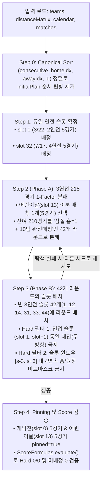

# KBO 일정 최적화 초기해 직접 구축 계획서 (Finalized Plan)

본 문서는 [`data/baseball/input_2025.json`](file:///Users/brown/workspace/optaplanner-practice/data/baseball/input_2025.json)의 `initialPlan`을 사용하지 않고, 문제 사실(`teams`, `distanceMatrix`, `calendar`, `matches`)만으로 **Hard 제약 위반이 0(`Hard 0/0`)인 초기해**를 직접 구축하여 Local Search로 연결하는 확정 계획서입니다.

---

## 1. 요구사항 및 설계 원칙 요약

1. **입력 데이터 범위**:
   * [`input_2025.json`](file:///Users/brown/workspace/optaplanner-practice/data/baseball/input_2025.json)에서 `teams`(10개 구단), `distanceMatrix`(100개 거리), `calendar`(45개 정규 슬롯 + 1개 더미 슬롯), `matches`(225개 시리즈: `home`, `away`, `consecutive`)만 읽습니다.
   * `initialPlan`은 읽지 않으며, `matches` 배열 순서에 내재된 기존 `initialPlan` 슬롯 순서 편향(Order Leak)을 정규 정렬로 제거합니다.
2. **하이브리드 최적화 구조**:
   * **초기해 생성기(`BaseballSolutionInitializer`)**: 솔버 실행 전 모든 Hard 제약(`hard0 = 0`, `hard1 = 0`)과 미배정 제약(`soft0 = 0`)을 만족하는 실행 가능 초기해를 직접 구축합니다.
   * **OptaPlanner Local Search**: 초기해의 `Hard 0/0` 상태를 유지하면서 Soft Score(구단별 이동 횟수 분산, 이동 거리 분산, 휴일 가중치 분산, 총 이동 거리)를 집중 최적화합니다.
3. **고정(Pinning) 규칙**:
   * **개막전(`2025-03-22`, `slot 0`, 2연전 5경기)** 및 **어린이날(`2025-05-05`, `slot 13`, 3연전 5경기)** 시리즈는 모두 배정 완료 후 `pinned = true` (`@PlanningPin`)로 고정합니다.

---

## 2. Grok 검토 의견 및 재검토(수용 여부) 요약

오른쪽 pane(`w3:p7`)의 Grok에게 초안을 검토받은 결과와 이에 대한 기술적 타당성 재검토 내역입니다.

| 검토 항목 | Grok의 주요 지적 사항 | 타당성 재검토 및 최종 반영 내용 |
| :--- | :--- | :--- |
| **1. 초기해 목표 품질 (`Hard 0/0` 필수 여부)** | 현재 [`baseballSolverConfig.xml`](file:///Users/brown/workspace/optaplanner-practice/src/main/resources/org/optaplanner/examples/baseball/solver/baseballSolverConfig.xml)은 `lateAcceptanceSize=2000`, `unimprovedStepCountLimit=300`으로 설정되어 있어, 팀/구장 중복이나 4연속이 남은 "강제 채우기 폴백" 해를 넘기면 300스텝 내에 복구하지 못하고 조기 종료됨. 초기해 완료 기준을 반드시 **Hard `0/0` + 미배정 `0`**으로 두어야 함. | **타당함 (전면 수용)** 프로토타입 검증 결과, 2단계(분해+배치) 알고리즘으로 **약 1~2ms 내에 `Hard 0/0` 초기해 생성이 가능**함을 확인함. 불완전 폴백을 제거하고 `Hard 0/0` 달성을 완료 조건으로 확정함. |
| **2. 알고리즘 2단계 분리 (분해 vs 슬롯 배치)** | 단일 DFS 안에서 10팀 완전 매칭(1-factor)과 직전 슬롯 대진 회피·4연속 홈/원정 회피를 동시에 섞으면 탐색이 꼬임. **(Phase A) 날짜 무관 42개 1-Factor 분해**와 **(Phase B) 42개 슬롯 배치**로 분리해야 함. | **타당함 (전면 수용)** Phase A(잠실 홈 1개 포함 완전 매칭 42개 분해)와 Phase B(비트마스크 기반 4연속 및 인접 동일 대진 하드 필터 배치)로 분리하여 구조적 단순성과 속도를 모두 확보함. |
| **3. 어린이날 매칭 선택과 Pinning 시점** | 어린이날 홈 의무 5팀과 상대 5팀의 완전 이분 매칭 후보는 120개(`5!`)이며 모두 동일한 홈/원정 비트와 휴일 점수를 가짐. 단, 어린이날 5경기를 먼저 고정해 두고 뒷단계만 재시도하면 잔여 그래프 분해가 막힐 때 복구 불가하므로, **어린이날 매칭 선택도 재시도 루프 안에 넣고 최종 완료 시점에 `pinned = true`를 마킹**해야 함. | **타당함 (전면 수용)** 어린이날 이분 매칭 선택을 Phase A의 첫 단계로 포함하여 필요 시 함께 재시도되도록 구성하고, 45개 슬롯 전체 배정이 끝난 후 `slot 0`(개막전)과 `slot 13`(어린이날)에 `setPinned(true)`를 일괄 적용함. |
| **4. 고정 슬롯(`slot 0, 13, 32`)의 양방향 인접 검사** | Phase B에서 슬롯을 순차 배치할 때 "직전 슬롯(`slot - 1`)"만 검사하면 이미 고정되어 있는 `slot 13`(어린이날) 직전인 `slot 12`나 `slot 32`(4연전) 직전인 `slot 31`에서 동일 대진 충돌 및 4연속 위반이 발생할 수 있음. 또한 [`ScoreFormulas.VisitFold`](file:///Users/brown/workspace/optaplanner-practice/src/main/java/org/optaplanner/examples/baseball/score/ScoreFormulas.java#L570-L631)는 날짜 간격(올스타 휴식기 등)과 무관하게 `slotIndex` 순으로 4연속을 판정함. | **타당함 (전면 수용)** 슬롯 배치 시 `slot - 1`뿐 아니라 이미 채워진 `slot + 1`과의 `sameMatchup`(방향 무관) 여부를 함께 검사하고, 슬롯 인덱스 기준 `[slot - 3 .. slot + 3]` 윈도우 전체에서 4연속 홈/원정 비트마스크를 검증함. |
| **5. 초기해 생성기 호출 위치 일원화** | `CustomPhaseCommand`와 `BaseballApp` 사전 초기화를 중복 적용하거나 setter만 호출하면 Bavet 증분 점수가 깨질 수 있음. 솔버 호출 전 `BaseballApp`에서 `Match.calendar`와 `Match.pinned`를 세팅하는 방식으로 일원화하는 것이 안전함. | **타당함 (전면 수용)** 특히 [`BaseballApp.java`](file:///Users/brown/workspace/optaplanner-practice/src/main/java/org/optaplanner/examples/baseball/app/BaseballApp.java#L43-L45)는 `solver.solve()` 호출 전에 초기해 엑셀(`unsolved_*.xlsx`)을 먼저 출력하므로, 솔버 진입 전에 초기해를 완성해 두어야 NPE 없이 기존 파이프라인과 완벽히 호환됨. |

---

## 3. 도메인 수학적 불변식 (Invariants)

[`input_2025.json`](file:///Users/brown/workspace/optaplanner-practice/data/baseball/input_2025.json)의 225개 시리즈와 45개 정규 캘린더 슬롯이 가지는 핵심 구조입니다.

1. **연전 수(`consecutive`)에 따른 완전 분리**:
   * `consecutive == 2`: 시리즈 **5개**, 캘린더 슬롯 **1개** (`slot 0`, `2025-03-22` 개막전) → 5개 시리즈가 유일한 1개 슬롯에 확정 배정 (`pinned = true`).
   * `consecutive == 4`: 시리즈 **5개**, 캘린더 슬롯 **1개** (`slot 32`, `2025-07-17` 올스타 브레이크 직후) → 5개 시리즈가 유일한 1개 슬롯에 확정 배정 (`pinned = false`).
   * `consecutive == 3`: 시리즈 **215개**, 캘린더 슬롯 **43개** (`slot 13` 어린이날 포함) → 어린이날 1개 슬롯(5시리즈, `pinned = true`) + 일반 3연전 42개 슬롯(210시리즈).
2. **잠실 구장 공유(`두산`, `LG`)의 비둘기집 원리**:
   * 10개 구단 중 `두산`과 `LG`만 `잠실종합운동장`을 공유합니다.
   * 3연전 215개 시리즈 중 **두산 홈 = 23개**, **LG 홈 = 20개**로 합계가 **정확히 43개**(= 3연전 슬롯 수 43개)입니다.
   * 하루 5개 구장 제약(`STADIUMS_PER_DAY = 5`)을 만족하려면 한 슬롯에 두산과 LG가 동시에 홈일 수 없으므로, **43개 모든 3연전 슬롯마다 반드시 두산 홈 또는 LG 홈 시리즈가 정확히 1개씩 배정**되어야 합니다(어느 한 슬롯이라도 두산·LG가 모두 원정이면 다른 슬롯에서 반드시 잠실 충돌 발생).

---

## 4. 초기해 직접 구축 알고리즘 설계 (`BaseballSolutionInitializer`)

### Step 0: 입력 데이터의 `initialPlan` 순서 편향 제거 (Canonical Ordering)
* [`input_2025.json`](file:///Users/brown/workspace/optaplanner-practice/data/baseball/input_2025.json)의 `matches` 배열은 기존 `initialPlan`과 동일한 순서(슬롯 0의 5경기, 슬롯 1의 5경기, ...)로 저장되어 있습니다.
* 초기해 생성기 진입 시 `Match` 리스트를 `(consecutive, home.index, away.index, id)` 기준으로 결정론적 정렬(Canonical Sort)하고, 팀별·대진별 버킷(`Deque<Match>[consecutive][homeIdx][awayIdx]`)에 적재하여 기존 정답 순서 정보를 완전히 소거합니다.

### Step 1: 유일 연전 슬롯(`consecutive = 2, 4`) 확정
* `consecutive == 2`인 정규 슬롯(`slot 0`, `2025-03-22`)과 `consecutive == 4`인 정규 슬롯(`slot 32`, `2025-07-17`)에 각각 해당 연전 수의 5개 시리즈를 매칭합니다.
* 사전 검증: 각 5개 시리즈가 10개 구단 완전 매칭(`teamMask == 0x3FF`)이고 5개 고유 구장(`stadiumMask` 비트 수 = 5)인지 검증합니다.

### Step 2 (Phase A): 3연전 215시리즈의 라운드(1-Factor) 분해
시드(`seed = 0, 1, 2, ...`) 기반 재시도 루프 내에서 날짜 순서와 무관하게 215개 3연전 시리즈를 **어린이날 라운드 1개 + 일반 라운드 42개**로 분해합니다.
1. **어린이날(`slot 13`, `2025-05-05`) 이분 매칭 선택**:
   * 홈 의무 구단 5팀(`Constants.HOME_OBLIGATION_CHILDREN`: `두산, 키움, 한화, NC, 롯데`)과 원정 5팀(`LG, SSG, KT, 삼성, KIA`) 사이의 1:1 완전 이분 매칭(5시리즈)을 선택하고 잔여 3연전 다중도 행렬(`remaining[home][away]`)에서 차감합니다.
   * 두산이 홈 의무 구단이고 LG가 원정 구단이므로 잠실 단일 홈 조건이 자동 충족됩니다.
2. **나머지 210개 시리즈의 42개 라운드 분해**:
   * 42회 반복하며 매 라운드마다:
     * **잠실 홈 시리즈 1개 우선 선택**: `home == 두산` 또는 `home == LG`인 잔여 시리즈 중 1개를 먼저 고릅니다.
     * **나머지 8개 구단 완전 매칭 (깊이 4 DFS)**: 아직 매칭되지 않은 팀 중 인덱스가 가장 작은 팀을 기준으로 잔여 다중도(`remaining[h][a]`)가 큰 간선부터 우선 탐색하여 4개 시리즈를 추가 선택합니다(이때 다른 잠실 팀이 홈으로 들어오는 간선은 배제하여 잠실 홈 = 1 유지).

### Step 3 (Phase B): 42개 라운드의 캘린더 슬롯 배치 (Bitmask Backtracking)
`slot 0`(2연전), `slot 13`(어린이날), `slot 32`(4연전)가 고정된 길이 45의 슬롯 배열(`schedule[0..44]`)에서 나머지 42개 빈 슬롯에 Phase A에서 만든 42개 라운드를 백트래킹으로 배치합니다.
* 각 라운드 $R$에 대해 사전 계산하는 메타데이터:
  * `int homeMask`: 10개 구단 중 해당 라운드에서 홈인 5개 구단의 비트마스크 (`0..0x3FF`)
  * `long pairMask` (또는 `int[5] unorderedPairs`): 무방향 대진 쌍(`min(h, a) * 10 + max(h, a)`) 5개의 집합
* 슬롯 `s`에 라운드 $R$을 배치할 때의 **Hard Pruning 조건**:
  1. **연속 동일 대진 금지 (`hard1 == 0`)**:
     * `schedule[s - 1]`(존재 시) 및 **`schedule[s + 1]`(이미 고정된 `slot 13`, `slot 32` 인접 시)**의 무방향 대진 쌍과 단 하나도 겹치지 않아야 함([`ScoreFormulas.sameMatchup`](file:///Users/brown/workspace/optaplanner-practice/src/main/java/org/optaplanner/examples/baseball/score/ScoreFormulas.java#L113-L116)과 동일 기준).
  2. **4연속 홈/원정 시리즈 금지 (`hard0` 내 `streakPenalty == 0`)**:
     * 슬롯 인덱스 윈도우 `w ∈ [max(0, s - 3) .. min(41, s)]`에 대해 연속된 4개 슬롯 `w, w+1, w+2, w+3`이 모두 채워졌을 때:
       * 4연속 홈 검사: `(m0 & m1 & m2 & m3) == 0`
       * 4연속 원정 검사: `((~m0 & ~m1 & ~m2 & ~m3) & 0x3FF) == 0`
* 탐색 스텝 제한(예: 5,000 노드) 내에 배치를 찾지 못하면 즉시 다음 시드로 넘어가 Phase A/B를 재시도합니다. (Python 프로토타입 실험 결과, 첫 번째 시드 `(0, 0)`에서 **약 1.8ms** 만에 `Hard 0/0` 해 도출 확인)

### Step 4: `Match` 엔티티 반영, Pinning 및 점수 검증
1. 확정된 45개 슬롯의 각 라운드 대진(`(consecutive, homeIdx, awayIdx)`)에 맞춰 Step 0의 버킷에서 실제 `Match` 인스턴스를 꺼내 `match.setCalendar(calendar)`를 설정합니다.
2. **Pinning 적용**:
   * 개막전 슬롯(`slot 0`, `2025-03-22`)에 배정된 5개 `Match`와 어린이날 슬롯(`slot 13`, `2025-05-05`)에 배정된 5개 `Match`에 `match.setPinned(true)`를 설정합니다(총 10개 시리즈 고정, 나머지 215개 시리즈는 `pinned = false`).
3. **사전 검증 (Fail-Fast)**:
   * [`ScoreFormulas.evaluate()`](file:///Users/brown/workspace/optaplanner-practice/src/main/java/org/optaplanner/examples/baseball/score/ScoreFormulas.java#L286)를 호출하여 초기해의 점수가 `hardScore(0) == 0L`, `hardScore(1) == 0L`, `softScore(0) == 0L`인지 검증합니다.

---

## 5. 파일별 변경 및 구현 계획

| 구분 | 대상 파일 | 주요 변경 내용 |
| :--- | :--- | :--- |
| **신규 추가** | `src/main/java/org/optaplanner/examples/baseball/solver/BaseballSolutionInitializer.java` | • `initialize(BaseballSolution solution)` 및 시드 지정 오버로드 `initialize(BaseballSolution solution, long seed)` 구현 • Step 0(정규 정렬) ~ Step 4(분해·배치·Pinning·Hard 0/0 검증) 수행 |
| **수정** | [`src/main/java/org/optaplanner/examples/baseball/app/BaseballApp.java`](file:///Users/brown/workspace/optaplanner-practice/src/main/java/org/optaplanner/examples/baseball/app/BaseballApp.java) | • `main()`에서 기존의 `setInitialPlan(jsonObject, unsolvedSolution)` 호출을 `BaseballSolutionInitializer.initialize(unsolvedSolution)`으로 교체 • `makeMatchInfo()`에서 로드된 `matchList`가 `initialPlan` 순서에 의존하지 않도록 정규화 |
| **테스트 추가/보강** | [`src/test/java/org/optaplanner/examples/baseball/score/BaseballScoreParityTest.java`](file:///Users/brown/workspace/optaplanner-practice/src/test/java/org/optaplanner/examples/baseball/score/BaseballScoreParityTest.java) | • `initialPlan` 없이 `BaseballSolutionInitializer.initialize(solution)`로 생성한 초기해가   1) 225개 전 경기 정규 슬롯 배정(`soft0 == 0`),   2) `Hard 0/0` 달성,   3) 개막전 5경기 및 어린이날 5경기 총 10경기 `pinned == true` 설정,   4) `FULL_ASSERT` 모드 Local Search 구동 시 Score Corruption 없이 Soft Score가 개선되는지 검증하는 테스트 추가 |

---

## 6. 검증 계획 (Verification Plan)

1. **단위 테스트 검증 (`mvn test`)**:
   * `matches` 배열을 임의로 섞은(Shuffle) 입력에 대해서도 `BaseballSolutionInitializer`가 항상 동일한 결정론적(Deterministic) `Hard 0/0` 초기해를 생성하는지 확인합니다(기존 `initialPlan` 순서 의존성 0% 증명).
   * 생성된 초기해에서 개막일(`2025-03-22`) 5경기와 어린이날(`2025-05-05`) 5경기만 `isPinned() == true`이고, 어린이날 홈 팀이 `HOME_OBLIGATION_CHILDREN` 5개 구단과 일치하는지 확인합니다.
   * `FULL_ASSERT` 모드로 OptaPlanner Solver(Local Search)를 실행하여 Bavet 증분 점수와 `BaseballEasyScoreCalculator` 점수가 모든 스텝에서 일치하고 Soft Score가 정상 개선되는지 검증합니다.
