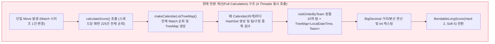
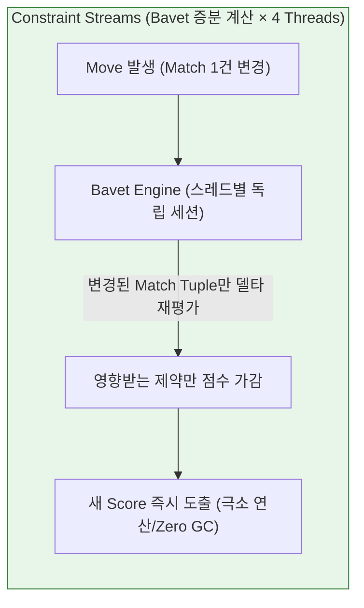
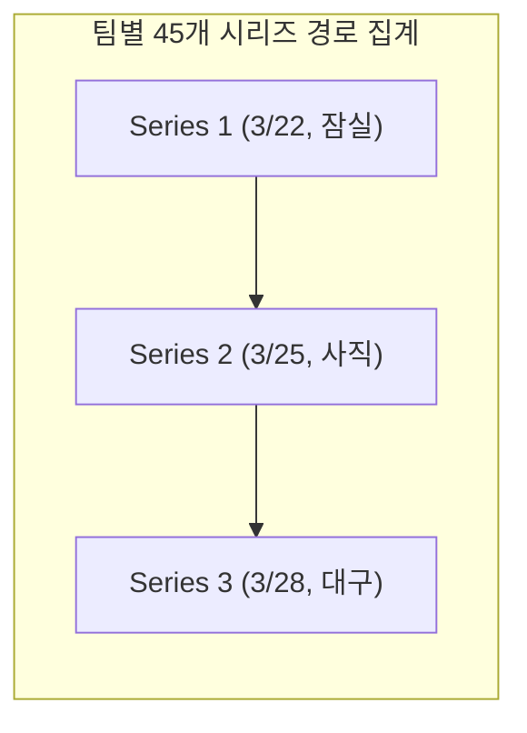
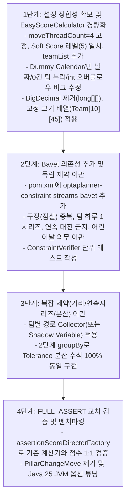

# OptaPlanner 점수 계산기(Score Calculator) 성능 분석 및 개선 대안

## 1. 개요
현재 KBO 야구 경기 일정 생성 알고리즘은 [`BaseballEasyScoreCalculator`](../src/main/java/org/optaplanner/examples/baseball/score/BaseballEasyScoreCalculator.java)를 사용하여 스케줄의 적합성을 평가하고 있습니다.
하지만 `EasyScoreCalculator` 인터페이스는 탐색 과정의 모든 스텝(Move)마다 전체 솔루션을 전량 재계산(Full Recalculation)하기 때문에, 멀티스레드(`moveThreadCount = 4`) 환경에서도 탐색 공간이 커질수록 심각한 성능 병목과 GC 부하가 발생합니다.

본 문서는 현재 프로젝트 환경(**OptaPlanner 9.44.0.Final**, **Java 25**, **`moveThreadCount = 4`**)과 실제 데이터셋([`input_2025.json`](../data/baseball/input_2025.json))을 기준으로 현재 계산기의 성능 병목 및 논리적 결함을 진단하고, 개선 대안과 단계별 전환 로드맵을 분석·정리합니다.

### 1.1. 도메인 모델 및 데이터셋 규모 ([`input_2025.json`](../data/baseball/input_2025.json) 기준)
- **`Match` (총 225개 Planning Entity)**: 단일 경기가 아니라 **'2연전 또는 3연전 시리즈(Series)'** 1건을 의미합니다(개막 2연전 5개 + 3연전 220개 = 총 225시리즈, 팀당 45시리즈).
- **`Calendar` (총 46개 Problem Fact)**: 정규 시리즈 시작일 슬롯 45개(`id = 0..44`) + 미배정 수용을 위한 Dummy 슬롯 1개(`id = 9999L`, `2100-12-31`).
- **`Team` (총 10개) 및 구장(총 9개)**: 10개 구단 중 **LG와 두산이 `'잠실종합운동장'`을 공유**하므로 고유 구장 수는 9개입니다. 따라서 하루 5개 시리즈가 열릴 때 5개 구장이 모두 달라야 한다는 제약은 실질적으로 **"LG와 두산의 잠실 홈 시리즈 중복 방지"** 역할을 수행합니다.

---

## 2. 현재 `BaseballEasyScoreCalculator`의 병목 및 결함 분석

OptaPlanner의 Local Search 단계에서는 4개의 Move 스레드(`moveThreadCount = 4`)가 동시에 초당 수천~수만 번의 탐색(Move: ChangeMove, SwapMove, PillarSwapMove 등)을 수행합니다. 현재 구조는 다음과 같은 구조적 병목과 계산 왜곡 문제를 가지고 있습니다.



### 2.1. 전량 재계산 (Full Recalculation) 오버헤드
- **원인**: 단 하나의 시리즈(`Match`) 일정(`Calendar`)만 변경되었음에도 불구하고, 매 Move마다 전체 225개 시리즈와 45개 캘린더 슬롯, 10개 팀의 전체 방문 경로를 처음부터 다시 분류하고 집계합니다.
- **영향**: Move당 시간 복잡도가 최소 $O(N \log N)$에 달하여, 4개의 스레드를 가동하더라도 초당 Move 처리량(Moves/sec)이 현저히 떨어집니다.

### 2.2. 과도한 객체 할당 및 GC(Garbage Collection) 부하
4개의 Move 스레드가 동시에 `calculateScore()`를 호출하면서 막대한 단명(Short-lived) 객체를 힙에 쏟아냅니다:
- `makeCalendarListTreeMap()`: 매 Move마다 `TreeMap<Calendar, List<Match>>` 및 수십 개의 `ArrayList` 인스턴스 할당.
- 루프 내부: `teamDuplicationCheck`, `stadiumDuplicationCheck`, `prevMatch` 등 매 날짜별 `HashSet<String>` 반복 생성 및 문자열 접합(`homeTeam + awayTeam`)으로 인한 `StringBuilder`/`byte[]` 할당.
- 어린이날 체크: 매 경기마다 `calendar.getStartTime().toString().contains(...)`를 호출하여 불필요한 문자열 변환 수행.
- `BigDecimal` 남발: `pow()`, `add()`, `divide()` 호출 시마다 불변 객체 생성.
- **영향**: 4개 스레드에서 동시에 발생하는 극심한 힙 할당으로 인해 GC가 빈번하게 발생하고, CPU 자원이 탐색 대신 메모리 할당/회수에 소모됩니다.

### 2.3. 날짜 정렬 오버헤드
- 팀별 이동 경로(45개 시리즈 순서)를 계산하기 위해 매번 10개 팀의 `TreeMap<LocalDateTime, Team>`을 새로 빌드하여 레드-블랙 트리 정렬을 수행합니다.
- 이미 순서가 정해진 캘린더(`id = 0..44`) 정보를 매 Move마다 동적으로 재정렬하는 낭비가 발생합니다.

### 2.4. 기존 코드의 논리적 결함 및 불일치 (리팩토링 시 교정 필수)
1. **Score 레벨 정의 불일치**:
   - [`BaseballSolution.java`](../src/main/java/org/optaplanner/examples/baseball/domain/BaseballSolution.java)에는 `@PlanningScore(bendableHardLevelsSize = 2, bendableSoftLevelsSize = 4)`로 선언되어 있으나, 실제 [`BaseballEasyScoreCalculator.java`](../src/main/java/org/optaplanner/examples/baseball/score/BaseballEasyScoreCalculator.java)는 **Hard 2개, Soft 5개** 배열을 반환하고 있습니다. (`bendableSoftLevelsSize = 5`로 일치 필요)
2. **Dummy Calendar(`id = 9999L`) 및 미배정(`null`) 경기의 점수 오염**:
   - `makeCalendarListTreeMap()`에서 `calendar == null`인 경기를 마지막 캘린더(Dummy Calendar, `id = 9999L`)에 몰아넣은 뒤, 날짜별 루프([58행](../src/main/java/org/optaplanner/examples/baseball/score/BaseballEasyScoreCalculator.java#L58))에서 Dummy Calendar를 건너뛰지 않아 **미배정 경기들이 하루 5경기/10팀/5구장 중복 위반(`duplicationHardScore`) 및 팀별 이동 경로(`visitOrderByTeam`)에 모두 합산**되어 점수를 왜곡합니다.
3. **동일 날짜 팀 중복 시 `visitOrderByTeam` 덮어쓰기 버그**:
   - 탐색 도중 한 팀이 같은 날 2개 이상의 시리즈에 배정되면 `TreeMap<LocalDateTime, Team>`의 키(`startTime`)가 충돌하여 앞선 경기의 방문 기록이 유실됩니다.
4. **빈 날짜 발생 시 `prevMatch`(연속 대진 금지) 비교 왜곡**:
   - `makeCalendarListTreeMap()`에는 경기가 1개 이상 배정된 `Calendar`만 포함됩니다. 탐색 중 특정 날짜 슬롯에 경기가 0건이 되면 그 날짜를 건너뛰고 이전 날짜와 다음 날짜를 연속된 시리즈로 오인하여 비교합니다.
5. **휴일 홈시리즈가 0건인 팀의 분산 계산 누락**:
   - `calculateHolidayScore()`에서 평균은 10개 팀(`/ 10`)으로 나누지만, 편차 제곱합 루프는 `holidayByTeam.keySet()`만 순회합니다. 특정 팀의 휴일 홈시리즈가 0건이면 맵에 키가 없어 해당 팀의 편차(`|0 - mean|`)가 페널티에서 누락됩니다.
6. **`int` 캐스팅으로 인한 점수 오버플로우 위험**:
   - 반환 타입은 `BendableLongScore`(`long`)임에도 내부 점수 변수를 `int`로 선언하고 `distanceVariance.intValue()`로 절삭([205행](../src/main/java/org/optaplanner/examples/baseball/score/BaseballEasyScoreCalculator.java#L205))하고 있어, 큰 페널티 발생 시 `int` 오버플로우로 부호가 역전될 위험이 있습니다.
7. **미사용(Dead Code) 연산**:
   - 루프 내부에서 주중 이동(`weekdayDistance`, `weekdayMoveCount`)을 매번 계산하고 `calculateWeekdayScore()` 메서드가 작성되어 있으나, 최종 점수에는 반영되지 않고 CPU만 소모하고 있습니다.

---

## 3. OptaPlanner 9.44.0.Final 점수 계산 대안 비교

OptaPlanner 9.x부터는 기존의 Drools DRL(`scoreDrl`)이 완전히 제거(Removed)되었으며, 순수 Java 기반의 증분 엔진인 **Bavet**이 Constraint Streams의 기본 엔진으로 자리잡았습니다.

| 비교 항목 | 1. Constraint Streams (`Bavet` 엔진) | 2. Incremental Score Calculator | 3. EasyScoreCalculator 코드 최적화 | 4. Drools DRL (`scoreDrl`) |
| :--- | :---: | :---: | :---: | :---: |
| **증분 계산 지원** | **자동 지원 (Bavet 기본 엔진)** | **수동 직접 구현** | 미지원 (전량 재계산) | - |
| **성능 향상 (`4 Threads`)** | **수십 ~ 수백 배** | **이론상 최고 속도** | 3 ~ 5배 수준 | - |
| **구현 난이도** | 보통 (선언적 Java Stream) | 매우 높음 (버그 위험 큼) | 낮음 | - |
| **유지보수성** | 뛰어남 (타입 세이프, 단위테스트 용이) | 낮음 (Score Corruption 위험) | 높음 | - |
| **OptaPlanner 9.44 지원** | **공식 표준 (Default)** | 지원 | 지원 (프로토타입/검증용) | **지원 종료 (9.0+에서 제거됨)** |
| **추천도** | ⭐⭐⭐⭐⭐ (최우선 도입) | ⭐⭐ (선택적) | ⭐⭐⭐ (1단계 즉시 적용) | ❌ (사용 불가) |

---

## 4. 대안별 세부 분석

### 대안 1: Constraint Streams API (`ConstraintProvider` + `Bavet`) — [강력 추천]
OptaPlanner 9.44.0.Final의 표준 방식이며, 내부적으로 초경량 순수 Java 증분 엔진인 **Bavet** 위에서 동작합니다. `moveThreadCount = 4` 설정 시 각 Move 스레드가 독립된 Bavet 세션을 보유하여 락 경합(Lock Contention) 없이 고속으로 증분 점수를 계산합니다.



- **핵심 장점**:
  1. **완전한 증분 계산(Incremental Calculation)**: 매치 1건이 이동하면 해당 매치가 속한 날짜(`Calendar`) 및 해당 팀(`Team`)의 조건만 델타($\Delta$)로 갱신됩니다.
  2. **Bavet 엔진의 메모리 효율성**: 8.x의 Drools 엔진 대비 메모리 풋프린트가 훨씬 작고 리플렉션/GC 부하가 거의 없어 4개 스레드 병렬 탐색 효율이 극대화됩니다.
  3. **가독성 및 단위 테스트(`ConstraintVerifier`)**: 각 비즈니스 룰(어린이날 홈경기 의무, 잠실 구장 중복 금지 등)을 메서드 단위로 분리하고 독립적으로 검증할 수 있습니다.
- **예시 코드 구조 (Hard 2단계, Soft 5단계 기준)**:
  ```java
  public class BaseballConstraintProvider implements ConstraintProvider {
      private static final int HARD_LEVELS = 2;
      private static final int SOFT_LEVELS = 5;

      @Override
      public Constraint[] defineConstraints(ConstraintFactory factory) {
          return new Constraint[] {
              sameDaySameStadiumConflict(factory),
              consecutiveSameMatchupConflict(factory),
              childrensDayHomeMatchObligation(factory)
              // ...
          };
      }

      // 방법 A: 쌍(Pair) 기반 제약 (권장 표준 방식)
      private Constraint sameDaySameStadiumConflict(ConstraintFactory factory) {
          return factory.forEachUniquePair(Match.class,
                  Joiners.equal(Match::getCalendar),
                  Joiners.equal(match -> match.getHome().getStadium()))
              .filter((m1, m2) -> m1.getCalendar() != null && !m1.getCalendar().getId().equals(9999L))
              .penalizeLong(BendableLongScore.ofHard(HARD_LEVELS, SOFT_LEVELS, 0, 1L),
                  (m1, m2) -> 1L)
              .asConstraint("동일 날짜 동일 구장(잠실 등) 중복 배정 금지");
      }

      // 인접 시리즈(prev Calendar) 간 동일 대진(홈/원정 무관) 연속 금지
      private Constraint consecutiveSameMatchupConflict(ConstraintFactory factory) {
          return factory.forEach(Match.class)
              .filter(m -> m.getCalendar() != null && !m.getCalendar().getId().equals(9999L)
                        && m.getCalendar().getPrev() != null)
              .join(Match.class,
                  Joiners.equal(m -> m.getCalendar().getPrev(), Match::getCalendar))
              .filter((curr, prev) ->
                  (curr.getHome().equals(prev.getHome()) && curr.getAway().equals(prev.getAway())) ||
                  (curr.getHome().equals(prev.getAway()) && curr.getAway().equals(prev.getHome())))
              .penalizeLong(BendableLongScore.ofHard(HARD_LEVELS, SOFT_LEVELS, 1, 1L),
                  (curr, prev) -> 1L)
              .asConstraint("동일 두 팀 간 연속 시리즈(2연속 매칭) 금지");
      }
  }
  ```

> [!NOTE]
> **기존 `EasyScoreCalculator`와의 페널티 산식 차이 주의**:
> 기존 계산기는 한 날짜의 팀/구장/경기 수 위반을 `|고유 팀 수 - 10| + |고유 구장 수 - 5| + |경기 수 - 5|`로 계산합니다. 반면 위 예시처럼 `forEachUniquePair`를 사용하면 중복 쌍의 조합 수(${}_nC_2$)로 감점되므로, 3건 이상 중복 시 기존 계산기와 감점 폭이 달라집니다.
> 만약 `assertionScoreDirectorFactory`로 기존 계산기와 **점수를 1:1로 완전 일치**시키려면 `groupBy(Match::getCalendar, countDistinct(...))` 방식을 사용하고, `forEachUniquePair`로 개선할 경우에는 기존 계산기의 수식도 동일하게 맞춘 뒤 교차 검증해야 합니다.

> [!IMPORTANT]
> **Maven 의존성(`pom.xml`) 주의사항**:
> 현재 [`pom.xml`](../pom.xml)에는 `optaplanner-core-impl`만 선언되어 있습니다. OptaPlanner 9.44.0에서 Constraint Streams(`Bavet`)와 테스트 도구를 사용하려면 `pom.xml`에 아래 의존성을 반드시 추가(또는 `optaplanner-core`로 변경)해야 합니다.
> ```xml
> <dependency>
>   <groupId>org.optaplanner</groupId>
>   <artifactId>optaplanner-constraint-streams-bavet</artifactId>
> </dependency>
> <dependency>
>   <groupId>org.optaplanner</groupId>
>   <artifactId>optaplanner-test</artifactId>
>   <scope>test</scope>
> </dependency>
> ```

### 대안 2: Incremental Java Score Calculator (`IncrementalScoreCalculator`)
- **개념**: 엔티티 추가/제거 및 필드 변경 이벤트(`beforeVariableChanged`, `afterVariableChanged` 등)를 리스닝하여 개발자가 직접 점수를 가감하는 방식. (`moveThreadCount = 4` 환경에서는 스레드마다 별도의 Calculator 인스턴스가 생성됨)
- **평가**:
  - 오버헤드가 전혀 없으므로 이론상 가장 빠름.
  - 하지만 팀별 이동 거리 분산(Variance) 계산 및 시리즈 순서 변경 시 직전/직후 시리즈 상태 롤백, 캐싱 동기화 로직의 구현 난이도가 극도로 높음.
  - 점수가 어긋나는 **Score Corruption** 버그가 발생하기 쉬워 특수한 경우가 아니면 권장하지 않음.

### 대안 3: 기존 EasyScoreCalculator 코드 레벨 최적화 (1단계 즉시 적용 방안)
전면 리팩토링 전, 당장의 실행 속도를 3~5배 개선하기 위한 튜닝 포인트입니다.

> [!WARNING]
> **멀티스레딩(`moveThreadCount = 4`) 동시성 주의**:
> OptaPlanner는 `EasyScoreCalculator`를 **단일 인스턴스로 생성하여 4개의 Move 스레드가 동시에 호출**합니다. 따라서 객체 할당을 줄이겠다고 `HashSet`이나 `TreeMap`을 **클래스 멤버 필드로 선언해 공유하면 즉시 `ConcurrentModificationException` 및 동시성 버그가 발생**합니다.
> 재사용 버퍼가 필요하면 반드시 **`ThreadLocal`을 사용**하거나, 메서드 내부 지역 변수로 크기가 작은 **기본형 배열(`int[]`, `boolean[]`)**을 할당해야 합니다.

1. **기본형 배열(`int[]`, `boolean[]`) 및 인덱스 기반 집계**:
   - 팀(10개, `0..9`), 구장(9개, `0..8`), 정규 캘린더 슬롯(45개, `0..44`)에 정수 인덱스를 부여하고, `HashSet<String>`이나 `TreeMap<LocalDateTime, Team>` 대신 고정 크기 배열(`Team[10][45]`)이나 비트마스크(`int` 비트 연산)로 중복 및 방문 순서를 정렬 없이 $O(1)$로 체크합니다.
2. **`BigDecimal` 제거 및 거리 행렬(Lookup Matrix) 사전 구축**:
   - 팀 간 이동 거리를 `long[10][10]` 배열로 사전 계산하여 $O(1)$ 조회 및 CPU 기본 정수(`long`) 연산으로 대체합니다.
3. **도메인 플래그 전처리 및 Java 25 문법 활용**:
   - `Calendar`에 `boolean isDummy`, `boolean isChildrenDay`, `boolean isAllStarBreakTuesday` 등의 불변 플래그를 생성 시점에 세팅하여 `toString().contains(...)` 호출을 제거합니다.
   - 대진 키가 필요한 곳에는 문자열 접합(`homeTeam + awayTeam`) 대신 Java `record`(예: `record MatchUp(int homeIdx, int awayIdx)`) 또는 정수 인코딩(`homeIdx * 10 + awayIdx`)을 사용합니다.

---

## 5. 복잡 제약(이동 거리·연속 시리즈·분산) 및 Solver/JVM 최적화 설계

### 5.1. 팀별 방문 경로(이동 거리 및 4연속 홈/원정 시리즈 금지) 설계
야구 스케줄링에서 가장 까다로운 규칙은 **"팀별 이동 거리/횟수"** 및 **"동일 홈/원정 4연속 시리즈(12연전) 금지(`consecutive > 3`)"**입니다.
이를 최적화하는 방법은 2가지입니다:



- **설계 방안 A: 팀 단위 커스텀 `ConstraintCollector` 활용 (도메인 변경 최소화, 추천)**:
  - 정규 `Calendar` 슬롯은 총 45개(`id = 0..44`)로 고정되어 있습니다.
  - [`BaseballSolution`](../src/main/java/org/optaplanner/examples/baseball/domain/BaseballSolution.java)에 `@ProblemFactCollectionProperty List<Team> teamList`를 추가한 뒤, `Team`과 `Match`를 조인(홈 또는 원정 참여)하고 팀별로 `Calendar.id` 기준 정렬/배열 상태를 유지하는 커스텀 `UniConstraintCollector`를 사용하면, 특정 시리즈의 날짜가 바뀔 때 **해당 시리즈에 속한 두 팀(Home/Away)의 경로만 증분 재계산**됩니다.
- **설계 방안 B: Shadow Variable 도입 (`@CustomShadowVariable`)**:
  - 하나의 [`Match`](../src/main/java/org/optaplanner/examples/baseball/domain/Match.java)에는 **`home` 팀과 `away` 팀 두 팀이 참여**하므로, 단일 `previousMatch`가 아니라 `prevMatchForHome`, `nextMatchForHome`, `prevMatchForAway`, `nextMatchForAway` 4개의 포인터를 관리하거나 팀별 일정 슬롯(`TeamAssignment`)을 보조 엔티티로 분리해야 합니다.

### 5.2. Tolerance 기반 분산(Variance) 제약의 정확한 Bavet 구현
현재 `stabilizeDistanceScore`, `stabilizeHolidayScore`, `stabilizeMoveCountScore`는 **10개 팀 전체의 실시간 평균(mean)**을 구한 뒤, **Tolerance(허용 오차) 데드존과 계단식 버림(`Math.floor(diff / tolerance)`) 후 제곱**하는 비선형 공식을 사용합니다.
- **주의점**: 총 이동 거리와 총 이동 횟수는 스케줄에 따라 10개 팀의 전체 합계($\sum x_i$) 자체가 변하므로, 단순히 팀별 제곱합($\sum x_i^2$)으로 근사화하면 평준화가 아니라 총합 감소 쪽으로 바이어스가 발생합니다.
- **해결책 (2단계 `groupBy` 파이프라인)**:
  - 팀 수가 단 **10개**뿐이므로 수식을 근사화할 필요가 없습니다.
  - 1차로 `groupBy(Team, ...)`를 통해 각 팀의 합계(거리/이동횟수/휴일수)를 증분 집계(최대 10개 튜플)한 뒤, 2차로 **`groupBy(ConstraintCollectors.toList())`로 10개 팀의 수치를 모아 기존 Tolerance + Variance 공식을 그대로 계산**합니다.
  - 이렇게 하면 Move 발생 시 변경된 1~2개 팀의 합계만 증분 갱신되고, 마지막 단계에서는 크기 10짜리 리스트 연산만 수행되므로 **기존 수식과 100% 동일한 점수를 $O(1)$ 수준으로 계산**할 수 있습니다. (이때 휴일 홈시리즈가 0건인 팀도 누락되지 않도록 `teamList` Problem Fact를 기준으로 집계합니다.)

### 5.3. Solver Move Selector 및 Java 25 런타임 튜닝
1. **`PillarChangeMoveSelector` 제거 권장**:
   - 현재 [`baseballSolverConfig.xml`](../src/main/resources/org/optaplanner/examples/baseball/solver/baseballSolverConfig.xml#L50-L51)에는 `<pillarChangeMoveSelector/>`와 `<pillarSwapMoveSelector/>`가 모두 설정되어 있습니다.
   - 같은 날짜(`Calendar`)의 시리즈들을 다른 날짜와 맞바꾸는 `PillarSwapMove`와 달리, **`PillarChangeMove`는 한 날짜의 여러 시리즈를 이미 5개 시리즈가 배정된 다른 날짜로 일방 편입**시켜 100% 확률로 하루 5경기/10팀 하드 제약을 깨뜨립니다. 이를 제거하면 4개 Move 스레드가 유효한 탐색에만 집중할 수 있습니다.
2. **Java 25 런타임 최적화 옵션**:
   - **`-XX:+UseCompactObjectHeaders` (JEP 519, Java 25 정식 지원)**: 64비트 JVM의 객체 헤더 크기를 16바이트에서 8바이트로 축소하여, Bavet 엔진 내부의 수많은 Tuple/Node 객체 메모리 사용량을 절감하고 CPU L1/L2 캐시 적중률을 높입니다.
   - **`-XX:+UseZGC` (Generational ZGC)**: 멀티스레드 탐색 중 발생하는 GC 일시 정지(Pause time)를 최소화하여 4개 스레드의 탐색 처리량(Moves/sec)을 일정하게 유지합니다.

---

## 6. 단계별 추진 로드맵

> [!TIP]
> **권장 로드맵 (단계별 전환 및 교차 검증)**:
> `moveThreadCount = 4` 설정을 고정한 상태에서 아래 순서대로 점진적으로 전환하고, OptaPlanner의 `assertionScoreDirectorFactory`를 활용해 점수 정합성을 검증합니다.



1. **1단계 (즉시 적용 가능 — 기반 정리 및 경량화)**:
   - [`baseballSolverConfig.xml`](../src/main/resources/org/optaplanner/examples/baseball/solver/baseballSolverConfig.xml)의 `<moveThreadCount>4</moveThreadCount>` 고정 및 불필요한 `<pillarChangeMoveSelector/>` 제거 검토.
   - [`BaseballSolution.java`](../src/main/java/org/optaplanner/examples/baseball/domain/BaseballSolution.java)의 `@PlanningScore` Soft 레벨 크기를 `5`로 수정하고 `List<Team> teamList`(`@ProblemFactCollectionProperty`) 추가.
   - [`BaseballEasyScoreCalculator`](../src/main/java/org/optaplanner/examples/baseball/score/BaseballEasyScoreCalculator.java)에서 Dummy Calendar(`9999L`) 필터링 누락, `int` 캐스팅 오버플로우, 미사용 주중 이동 코드를 정리하고, `TreeMap` 대신 고정 크기 인덱스 배열(`Calendar` 45슬롯 × `Team` 10개) 및 `long[10][10]` 거리 행렬 적용.
2. **2단계 (Bavet 엔진 도입 및 기본 제약 이관)**:
   - [`pom.xml`](../pom.xml)에 `optaplanner-constraint-streams-bavet` 및 `optaplanner-test` 추가.
   - `BaseballConstraintProvider` 클래스 신설 후 하루 시리즈 수, 구장(잠실) 중복, 연속 대진 방지, 어린이날 홈경기 등 단일/쌍 제약부터 작성 및 `ConstraintVerifier` 테스트 구축.
3. **3단계 (고급 제약 최적화)**:
   - 이동 거리, 4연속 홈/원정 시리즈 제한(`consecutive > 3`), Tolerance 기반 분산(휴일/이동 횟수/이동 거리) 제약을 팀별 `ConstraintCollector` 및 2단계 `groupBy`로 구현.
4. **4단계 (검증 및 최종 전환)**:
   - `baseballSolverConfig.xml`에서 `<assertionScoreDirectorFactory>`를 잠시 활성화하여 `BaseballConstraintProvider`와 `BaseballEasyScoreCalculator`의 점수 계산 결과가 일치하는지 검증.
   - 검증 완료 후 `constraintProviderClass`로 완전 전환하고, Java 25 옵션(`-XX:+UseCompactObjectHeaders`, `-XX:+UseZGC`)과 함께 `moveThreadCount = 4` 기준 초당 Move 속도(Moves/sec) 벤치마킹 수행.

---

## 7. 실측 벤치마크 결과 및 최종 적용 아키텍처

[`input_2025.json`](../data/baseball/input_2025.json)(225개 시리즈, `initialPlan` 적용)을 대상으로 동일 조건(**`moveThreadCount = 4`**, `REPRODUCIBLE`, 3초 워밍업 후 **10초간 실제 Local Search 구동**)에서 측정한 단계별 성능 비교 결과입니다.

### 7.1. 단계별 탐색 속도(`score calculation speed`) 비교

| 단계 | 점수 계산 방식 | 초당 점수 계산 속도 (`/sec`) | 10초간 채택된 Step 수 | 10초 후 도달 점수 (Soft Score) | 변경 전 대비 속도 향상 |
| :--- | :--- | :---: | :---: | :---: | :---: |
| **0. 변경 전 (Legacy)** | 기존 `BaseballEasyScoreCalculator`<br/>(`TreeMap` + `HashSet` + `BigDecimal`) | **86,179 / sec** | 32 steps | `[0/0/0/-32/-70318]` | **1.00x (기준)** |
| **1. Bavet 1차 전환** | [`BaseballConstraintProvider`](../src/main/java/org/optaplanner/examples/baseball/score/BaseballConstraintProvider.java)<br/>(일반 `toList()` + 노드 미공유) | **86,585 / sec** | 42 steps | `[0/0/0/-14/-72615]` | **1.01x** |
| **2. Bavet 고도화** | [`BaseballConstraintProvider`](../src/main/java/org/optaplanner/examples/baseball/score/BaseballConstraintProvider.java)<br/>(**스트림 노드 공유 + `TeamRouteCollector`**) | **182,826 / sec** | 84 steps | `[0/0/0/-13/-72505]` | **2.12배 향상** |
| **3. Easy 1차 경량화** | [`BaseballEasyScoreCalculator`](../src/main/java/org/optaplanner/examples/baseball/score/BaseballEasyScoreCalculator.java)<br/>(`long` 거리 행렬 + 슬롯 버킷 리스트) | **388,366 / sec** | 177 steps | `[0/0/0/-13/-72505]` | **4.51배 향상** |
| **4. Easy 최종 고도화** | [`BaseballEasyScoreCalculator`](../src/main/java/org/optaplanner/examples/baseball/score/BaseballEasyScoreCalculator.java)<br/>(**Single-Pass 원시 배열 + 비트마스크 + `ThreadLocal`**) | **950,435 / sec** | **434 steps** | **`[0/0/0/-4/-70686]`** | **11.03배 향상 🚀** |

*(※ 시작 점수는 모두 `[0/0]hard/[0/-400/-573307/-13/-72955]soft`로 동일하며, `EnvironmentMode.FULL_ASSERT` 교차 검증 테스트에서 `BaseballEasyScoreCalculator`와 `BaseballConstraintProvider`는 100스텝 동안 단 1점의 오차도 없이 100% 동일한 점수를 산출함을 검증 완료)*

### 7.2. 결과 분석 및 아키텍처 인사이트

1. **`BaseballConstraintProvider`(Bavet) 고도화 포인트 (8.6만 → 18.3만/sec, 2.12배)**:
   - OptaPlanner 9.44의 Bavet 엔진에서 `groupBy` 브리지 스트림은 별도 호출 시 노드가 자동 병합되지 않으므로, [`BaseballConstraintProvider.defineConstraints()`](../src/main/java/org/optaplanner/examples/baseball/score/BaseballConstraintProvider.java#L81-L99)에서 일별 그룹(`days`), 팀별 요약(`summaries`), 리그 합계(`totals`) 스트림 인스턴스를 각각 **단 1회만 생성한 뒤 여러 제약으로 분기(Node Sharing)**하여 중복 연산을 1/5로 줄였습니다.
   - 또한 `ConstraintCollectors.toList()`의 방어적 리스트 복사와 매번 정렬(`sort`)하는 비용을 없애기 위해 슬롯 인덱스 배열 기반의 커스텀 [`TeamRouteCollector`](../src/main/java/org/optaplanner/examples/baseball/score/BaseballConstraintProvider.java#L223-L245)([`TeamRouteAccumulator`](../src/main/java/org/optaplanner/examples/baseball/score/ScoreFormulas.java#L405))를 도입했습니다.
2. **Single-Pass [`BaseballEasyScoreCalculator`](../src/main/java/org/optaplanner/examples/baseball/score/BaseballEasyScoreCalculator.java)가 95만/sec(11.03배)를 달성한 이유**:
   - **작고 고정된 도메인 크기**: 엔티티가 개별 경기가 아닌 **시리즈(225개)** 단위이고 정규 슬롯이 **45개**, 팀이 **10개**로 고정되어 있습니다.
   - **Zero-Allocation & 비트마스크(`Integer.bitCount`)**: [`ScoreFormulas.evaluate()`](../src/main/java/org/optaplanner/examples/baseball/score/ScoreFormulas.java#L286-L304)는 `ThreadLocal<Scratch>` 내의 원시 배열(`int[45]`, `1 << index` 비트마스크)만 사용하여 **힙 객체 할당 0건, 정렬 0건, 단일 루프(225회)**로 모든 점수를 CPU L1 캐시 내에서 계산합니다.
   - **Undo Move 재계산 생략**: Local Search에서 기각(Undo)되는 대다수의 Move(특히 10개 시리즈를 맞바꾸는 `PillarSwapMove`)에서 Bavet은 이동(10건)과 복구(10건) 총 20번의 델타 이벤트를 처리해야 하지만, `EasyScoreCalculator`는 이동 시 1회만 계산하고 Undo 시에는 캐싱된 이전 점수로 즉시 복원합니다.
3. **최종 하이브리드 운영 구조**:
   - [`ScoreFormulas`](../src/main/java/org/optaplanner/examples/baseball/score/ScoreFormulas.java)에 모든 점수 산식을 단일 진실 공급원(Single Source of Truth)으로 통합하여 유지보수성을 확보했습니다.
   - 규칙 단위 테스트는 [`BaseballConstraintProvider`](../src/main/java/org/optaplanner/examples/baseball/score/BaseballConstraintProvider.java)와 `ConstraintVerifier`([`BaseballConstraintProviderTest`](../src/test/java/org/optaplanner/examples/baseball/score/BaseballConstraintProviderTest.java))로 독립 검증하고, [`BaseballScoreParityTest`](../src/test/java/org/optaplanner/examples/baseball/score/BaseballScoreParityTest.java)를 통해 두 계산기의 `FULL_ASSERT` 정합성을 상시 보장합니다.

